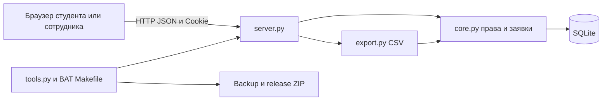

# Архитектура

ER: users 1—N tickets; users 1—N sessions; users 1—N audit; tickets 1—N audit.
Владельца заявке назначает сервер из сессии, не клиент. Смена статуса и запись
audit находятся в одной транзакции. Frontend использует textContent для пользовательских полей.
В schema.sql стоит user_version=1, повторный запуск создаёт только недостающие таблицы.
